# Handle Supply Chain Disruptions with agentic AI

<!-- TITLE: Handle Supply Chain Disruptions with agentic AI -->

This AI quickstart helps logistics operators simulate disruptions and query risk documents with an agentic AI on Red Hat® OpenShift® AI.

<!-- SHORT DESCRIPTION: This AI quickstart helps logistics operators simulate disruptions and query risk documents with an agentic AI on Red Hat® OpenShift® AI. -->

## Table of Contents

- [Detailed description](#detailed-description)
  - [See it in action](#see-it-in-action)
  - [Architecture diagrams](#architecture-diagrams)
- [Requirements](#requirements)
  - [Minimum hardware requirements](#minimum-hardware-requirements)
  - [Minimum software requirements](#minimum-software-requirements)
  - [Required user permissions](#required-user-permissions)
- [Deploy](#deploy)
  - [Prerequisites](#prerequisites)
  - [Installation](#installation)
    - [Deploy](#deploy-1)
    - [Open the frontend Route URL](#open-the-frontend-route-url)
  - [Exploring the deployment](#exploring-the-deployment)
    - [Running Simulations](#running-simulations)
    - [Ask impact questions](#ask-impact-questions)
    - [Create a new Scenario](#create-a-new-scenario)
    - [Live News Feed](#live-news-feed)
    - [Evaluate the agent responses with MLflow (optional)](#evaluate-the-agent-responses-with-mlflow-optional)
    - [Adapt flight data to your organization (optional)](#adapt-flight-data-to-your-organization-optional)
    - [Modifying the application (optional)](#modifying-the-application-optional)
  - [Delete](#delete)
- [Reference](#reference)
- [Tags](#tags)

## Detailed description

Global supply chains are exposed to port strikes, airspace closures, canal blockages, and similar events. Traditional dashboards can raise alerts, but they do not reason about the downstream impact or recommend diversions. Operators still have to piece together reports and expert judgment under time pressure.

This quickstart deploys an interactive supply chain impact workspace backed by an agent running in OGX, a PGVector knowledge base, and a general-simulation impact engine. Operators pick a seeded scenario, run natural-language impact queries, review scores, values at risk, affected entities, and recommended diversions on a Leaflet map, and chat with a RAG assistant grounded in risk analyses.

Typical use cases include operations centers modeling a Port of Los Angeles strike, a Suez blockage, or a GPS/airspace event before committing to a response. After deployment you can:

- Run seeded disruption scenarios and inspect spatial impact on a map
- Chat with a RAG assistant that auto-matches an OGX vector store by scenario
- Upload `.txt`, `.md`, or `.pdf` risk documents at runtime
- Propose and create new scenarios from natural language

### See it in action

Check out a live [video demo](https://www.loom.com/share/fd6dfe3b3f6a4dcb8aa48bcb6f3394ea)!

### Architecture diagrams

The quickstart consists of the following main components:
* Frontend - React-based UI which allows the user to interact with simulated events and to visualize the impact of these events on the supply chain.
* Backend application - Flask-based backend for the frontend
* General Simulation engine - uses domain-specific data (for example flight data) to simulate the impact of events on your supply chain
* Supply chain agent - agent built with [Langchain](https://github.com/langchain-ai/langchain) and [OGX](https://github.com/ogx-ai/ogx) which consumes uploaded risk documents and data generated from the general simulation engine to reason about and answer questions about supply chain disruptions.

Flight positions on the map come from [OpenSky](https://opensky-network.org/).
As OpenSky often blocks hyperscaler IPs by default, this data is seeded from the user's laptop.

Supply chain impact queries go from the UI through Flask to the general-simulation engine and the supply chain agent. Chat interactions are handled by the Flask backend and flow through a Langchain agent to OGX and then to a locally deployed or external model. External models are often hosted in an OpenShift AI Model-as-a-Service (MaaS) instance.

Tools are provided to the agent so that it can consume event-specific data from uploaded knowledge bases (in PGVector), the general-simulation engine results for the impact queries, and an RSS feed, enabling it to provide in-depth analysis and insight.

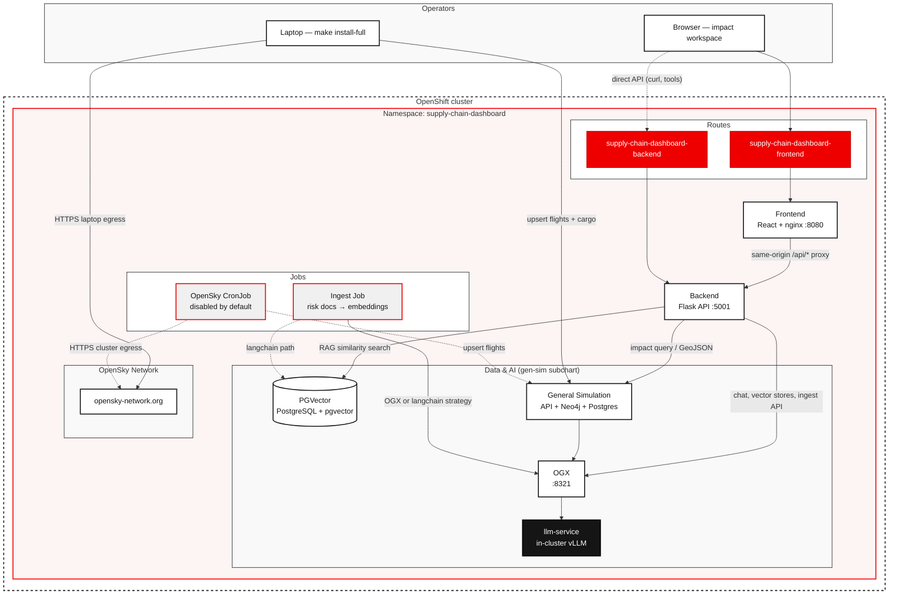


## Requirements

### Minimum hardware requirements

- CPU: 4 vCPU
- Memory: 16 GB
- Storage: 20 GB (PGVector + app)
- Models: tested with - [Llama-4-Scout-17B-16E](https://huggingface.co/meta-llama/Llama-4-Scout-17B-16E)

### Minimum software requirements

Tested with OpenShift AI 3.4+ on OpenShift 4.21+.

| Component | Version / use |
|-----------|----------------|
| OpenShift | 4.21+ |
| OpenShift AI | 3.4+ |
| Helm | 3.14+ |
| Python | 3.12 |
| Node.js | 22 (frontend builds) |
| Git | Required to clone the repository and submodule |
| GNU Make | Required to run the `make` targets |
| `oc` CLI | Required for deployment and troubleshooting |

These need to be installed before deploying the quickstart.

### Required user permissions

This quickstart can be deployed by a user with:

- Permission to create projects/namespaces
- Namespace **admin** on the target project (sufficient to create Routes, Deployments, Services, Jobs through helm deployments)

## Deploy

The quickstart uses these values by default (overridable on `make`, for example `make install-full NAMESPACE=my-ns`):

| Setting | Default |
|---------|---------|
| Helm chart | `./helm` |
| Release name | `supply-chain-dashboard` |
| Namespace | `supply-chain-dashboard` |
| Values file | `helm/values.yaml` |

Run `make help` for the full target list.

### Prerequisites

Before deploying, ensure you have:

- Access to a Red Hat OpenShift cluster with OpenShift AI 3.4+ installed
- `oc` CLI installed and authenticated
- `helm` CLI 3.14+ installed (`make` invokes Helm)
- API token for your OpenAI-compatible model endpoint. We have tested with
  [Llama-4-Scout-17B-16E](https://huggingface.co/meta-llama/Llama-4-Scout-17B-16E) but
  other equally capable models that support tool calling should work as well.
- Network access from the cluster to the model endpoint
- Outbound HTTPS so that the quickstart can access the RSS news feed

### Installation

#### Deploy

1. Clone the quickstart (general-simulation is included as a git submodule)

```bash
git clone --recurse-submodules https://github.com/rh-ai-quickstart/ai-supply-chain-agent.git
cd ai-supply-chain-agent
```

> **Already cloned without `--recurse-submodules`?** Run `make submodule-init` to pull the submodule.

2. Configure secrets

Start by making a copy of the default secrets file:

```bash
cp helm/secrets.example.yaml helm/secrets.yaml
```

While you can put secrets into the copied file helm/secrets.yaml, we
suggest you set them in the environment instead. Replace these sample values with your model endpoint details:

```bash
export MODEL_ID="your-model-name"
export MODEL_URL="https://your-model.example.com/v1"
export API_KEY="your-api-key"
```

> **Note**: Set `MODEL_URL` to the full endpoint URL, including the protocol and any required path (for example `https://my-model.example.com/v1`).

3. Validate model access

You can verify the model endpoint is reachable **before** installing:

```bash
oc run test-model-access --rm -it --restart=Never \
  --image=registry.access.redhat.com/ubi9/ubi-minimal:latest \
  --env="API_KEY=${API_KEY}" \
  --env="MODEL_ID=${MODEL_ID}" \
  --env="MODEL_URL=${MODEL_URL}" \
  -- /bin/sh -c 'curl -sf --max-time 10 \
    -H "Authorization: Bearer ${API_KEY}" \
    -H "Content-Type: application/json" \
    -d "{\"model\": \"${MODEL_ID}\", \"messages\": [{\"role\": \"user\", \"content\": \"Say hello in one word.\"}], \"max_tokens\": 10}" \
    "${MODEL_URL}/chat/completions" && echo "" && echo "SUCCESS" || echo "FAILED"'
```

4. Deploy

With the exported model settings, run:

```bash
make install-full
```

This installs the chart, seeds demo and flight data, and ingests the predefined knowledge bases. To use a non-default namespace, pass both `NAMESPACE` and `GEN_SIM_NAMESPACE`, for example `make install-full NAMESPACE=my-ns GEN_SIM_NAMESPACE=my-ns`.

#### Open the frontend Route URL

The UI Route URL is printed during installation:

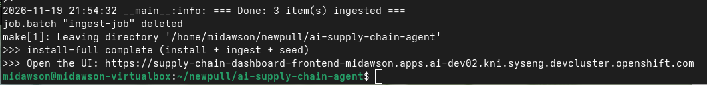

After `make install-full` completes, open the URL. The map should show the seeded flight data:

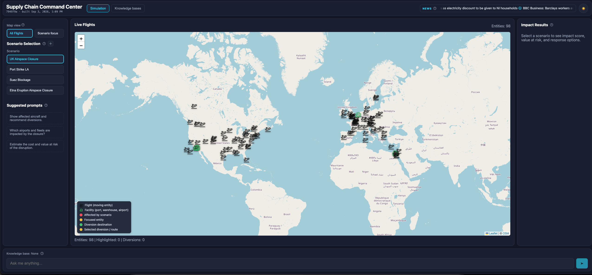

### Exploring the deployment

#### Running Simulations 

In the left hand panel there are options for scenarios to run. Click `UK Airspace Closure` in the UI. 

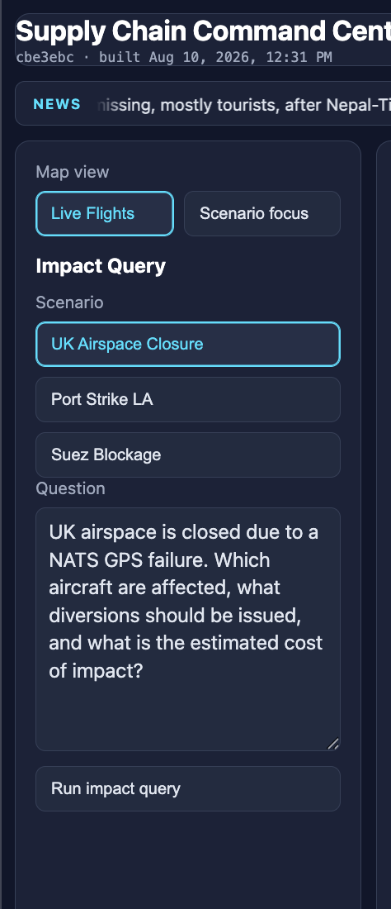

After the scenario runs you will notice the map zoom to the location of the event.

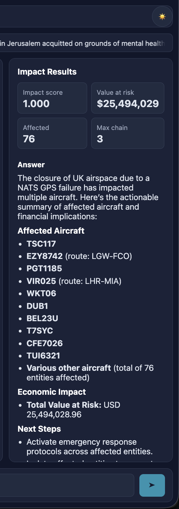

Once zoomed in, look at the right panel to see the impact results:

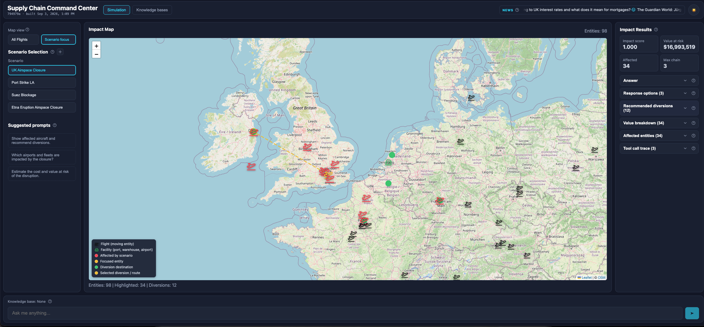

On that panel explore the different information the agent has provided for the scenario. For example, by opening the `Recommended diversions` section you can see the affected flights and then select a flight to see the recommended redirection:

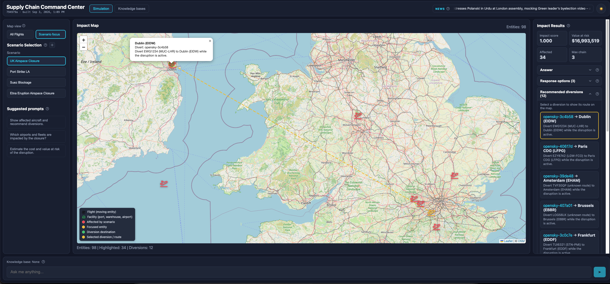

#### Ask impact questions

After running the scenarios, data is injected into the agent's memory and you can ask follow up questions about the event:

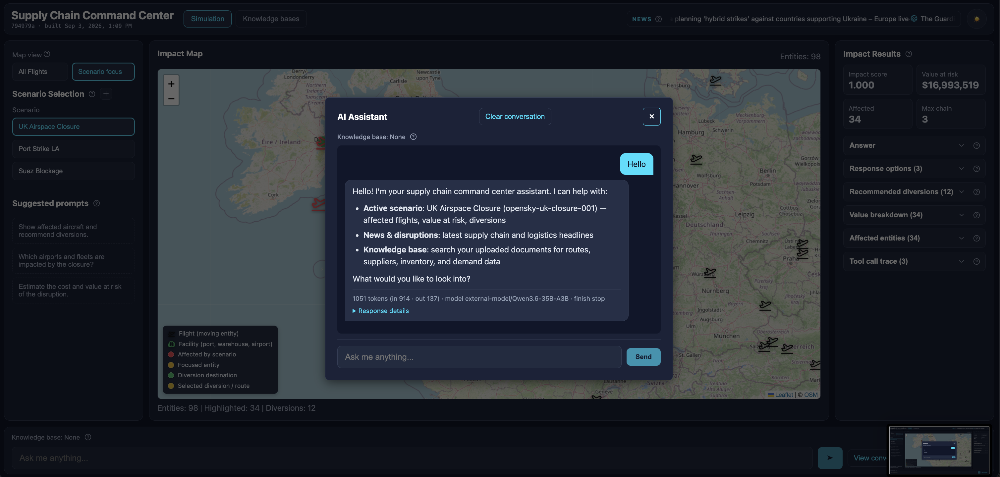

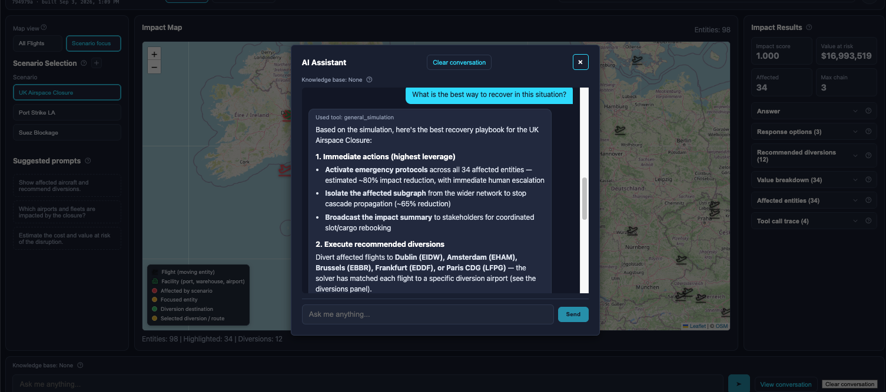

You can explore by asking your own questions.

#### Create a new Scenario

The quickstart includes a number of predefined scenarios, however, you can extend it with scenarios that may be more relevant
to your organization.

In the top bar of the application click the create scenario as shown in:

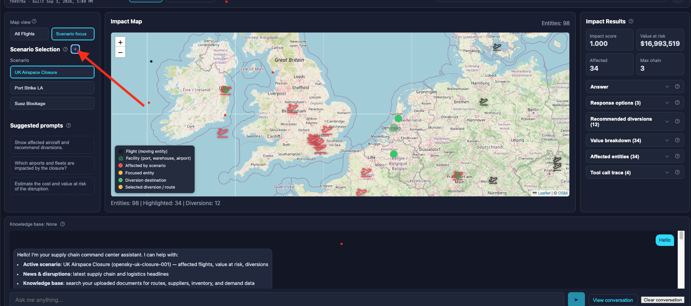

Once you click on the `+` the page looks as follows:

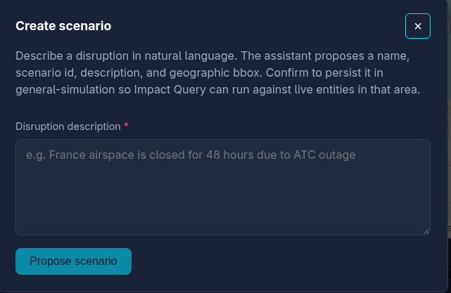

Create a scenario by using natural language like "Vesuvius erupts in Italy closing airspace"

The agent will then populate predefined fields which you can further refine then accept. You will notice
that the affected bounding box will have been automatically filled in based on the scenario, in our case covering
Italy.

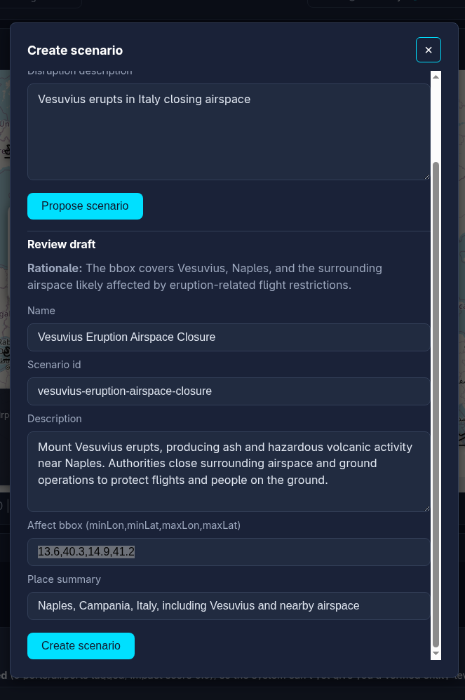

Once you select the "Create scenario" button it will save you the scenario and bring you back to the home page.
You should now see the new scenario in addition to the pre-configured ones:

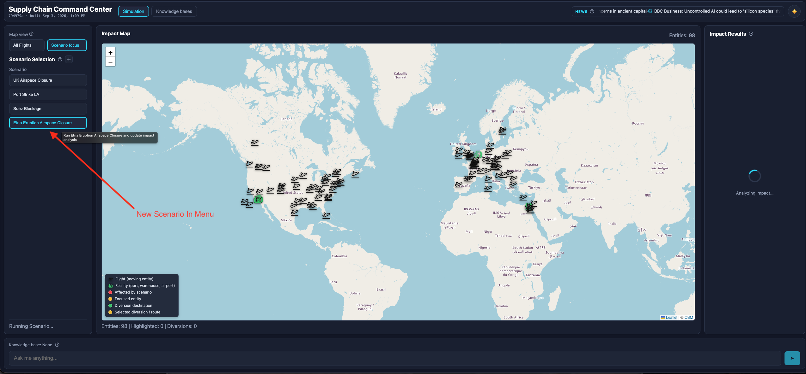

Next select the "Knowledge bases" option, and you should see a screen like:

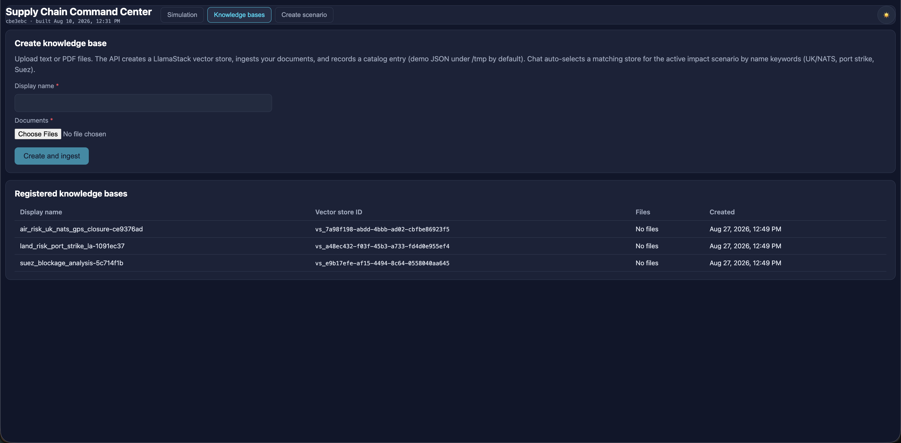

Next, add a knowledge base which is related to the scenario you just created. Make the display name `italy_volcano_eruptions` and
select the file `docs/knowledge-bases/italy_volcano_eruptions.txt` using Choose Files.

Select `Create and ingest` and you should see that a knowledge base was added:

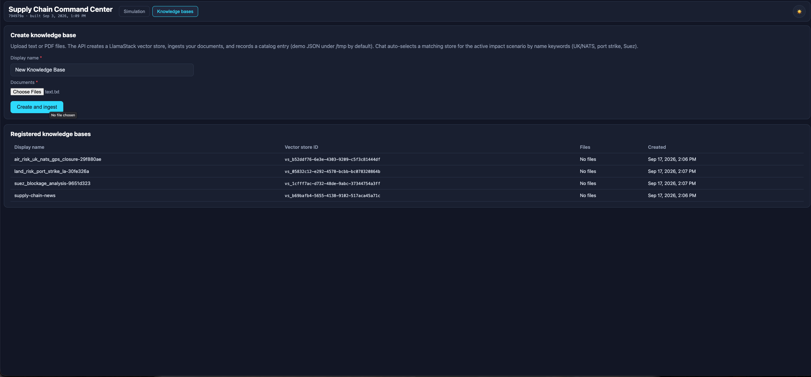

This knowledge base will be used by the agent when you trigger the new scenario.

Now go back to the main page and select the newly added scenario:

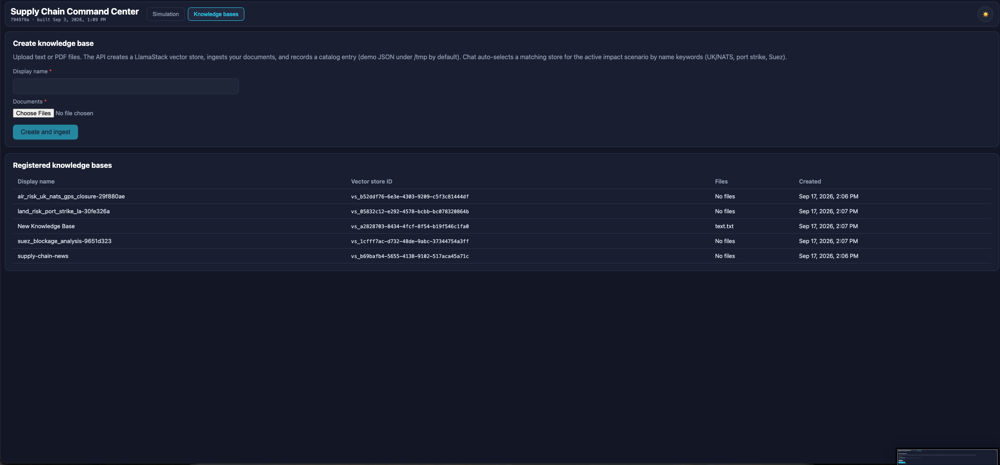

You will notice that the impact is centered on Italy. You can now go and ask impact questions as shown
earlier which will be grounded in the simulation for the new scenario and the knowledge base that was updated.

#### Live News Feed

In addition to the simulation results and knowledge bases, there is a RSS based live news feed which is injected into the context of the agent.
This makes the agent aware of current events and you can converse about how they might affect your supply chain or the scenario you are exploring.

Open the chat window and ask `Is there any news that might affect our supply chain?`. You should see a result like this which is grounded
in the current news from the newsfeed:

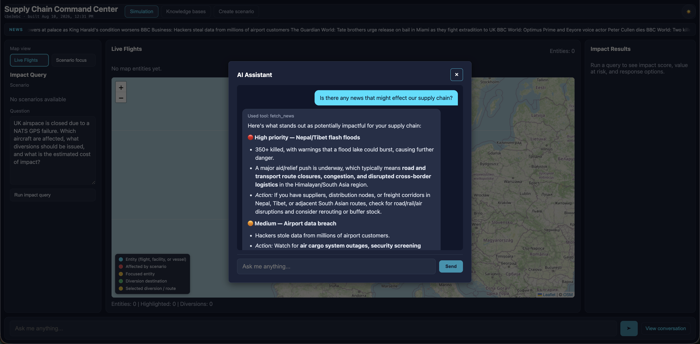


You can also create scenarios directly from the news feed which is shown at the top of the workspace:

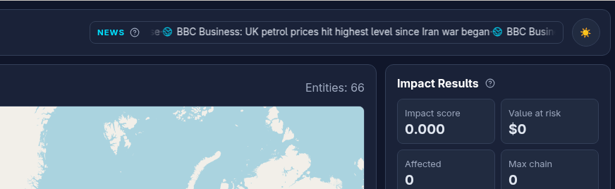

When you click one of the headlines in the live newsfeed it will help you create a scenario:

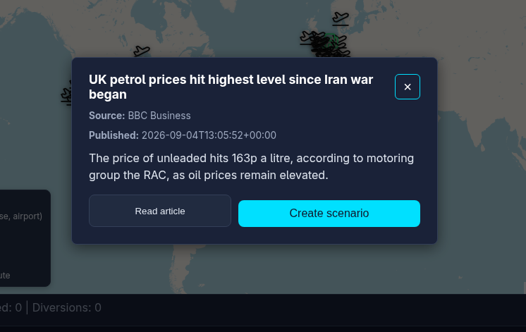

#### Evaluate the agent responses with MLflow (optional)

So far we've focussed on the application itself. An important part of building an AI application is
evaluating the responses from the agent. Unlike traditional applications we can't just check against
a fixed expected response as the agent could generate many different equally valid responses. To
handle variability we need to use a tool like [MLflow](https://mlflow.org/) which is integrated
into [OpenShift AI](https://www.redhat.com/en/products/ai/openshift-ai).

With MLflow, you can trace backend chat requests and evaluate the agent's responses.
This requires an OpenShift AI MLflow tracking server and an OpenAI-compatible judge model endpoint.

To get the tracking URI from the default OpenShift AI MLflow resource named `mlflow` using oc run:

```bash
export MLFLOW_TRACKING_URI="$(oc get mlflow mlflow -o jsonpath='{.status.url}')"
printf '%s\n' "$MLFLOW_TRACKING_URI"
```

Next set the values needed for the judge model:

```bash
export EVAL_JUDGE_MODEL_URL="https://<maas-route>/v1"
export EVAL_JUDGE_MODEL_ID="<model-id>"
export EVAL_JUDGE_API_KEY="<your key>"
```

Next re-install with evaluations enabled:

```bash
make helm-uninstall
export ENABLE_EVALS=true
make install-full
```

and finally:

run

```bash
make run-eval
```

`make run-eval` installs the local evaluation runner on its first invocation, drives the deployed UI through the seeded disruption questions, and writes evaluation scores and traces to an MLflow run. You should see output similar to the following:

```bash
make[1]: Nothing to be done for 'eval-ui-install'.
>>> Evaluating UI at https://supply-chain-dashboard-frontend-midawson.apps.ai-dev02.kni.syseng.devcluster.openshift.com
>>> MLflow experiment: supply-chain-disruption-evals-20261116T142406Z-r1
INFO:supply_chain_disruption_eval:Using MLflow judge endpoint https://maas-rhdp.apps.maas.redhatworkshops.io/v1/chat/completions
INFO:supply_chain_disruption_eval:Evaluating disruption: Port Strike LA (supply-chain-port-strike-la)
INFO:supply_chain_disruption_eval:Evaluating disruption: Suez Blockage (supply-chain-suez-blockage)
INFO:supply_chain_disruption_eval:Evaluating disruption: UK Airspace Closure (opensky-uk-closure-001)
INFO:supply_chain_disruption_eval:Some UI answers are not searchable in MLflow yet (13 traces visible); retrying in up to 2s
INFO:supply_chain_disruption_eval:Some UI answers are not searchable in MLflow yet (13 traces visible); retrying in up to 2s
INFO:supply_chain_disruption_eval:Adding MLflow built-in relevance, safety, and retrieval judges using the configured MaaS model and endpoint
INFO:supply_chain_disruption_eval:Scoring 13 question/answer pairs from MLflow chat traces

✨ Evaluation completed.

Metrics and evaluation results are logged to the MLflow run:
  Run name: seeded-disruptions-v1-news-unknown-20261116T202412Z
  Run ID: c64500acd97548b58c6877f68d42afca
View the evaluation results at https://<your cluster url>/mlflow/#/experiments/167/evaluation-runs?selectedRunUuid=c64500acd97548b58c6877f68d42afca

MLflow experiment: supply-chain-disruption-evals-20261116T142406Z-r1
MLflow run name: seeded-disruptions-v1-news-unknown-20261116T202412Z
MLflow run ID: c64500acd97548b58c6877f68d42afca
Results artifact directory: evaluation/
```

While tracing is enabled, the backend records model-backed chat requests, including user prompts, chat history, model responses, and function-call responses.

You can view the traces and evaluations in the MLflow UI. First open MLflow by selecting the 3 by 3 boxes at the top right of the OpenShift UI and then select MLflow from the dropdown:

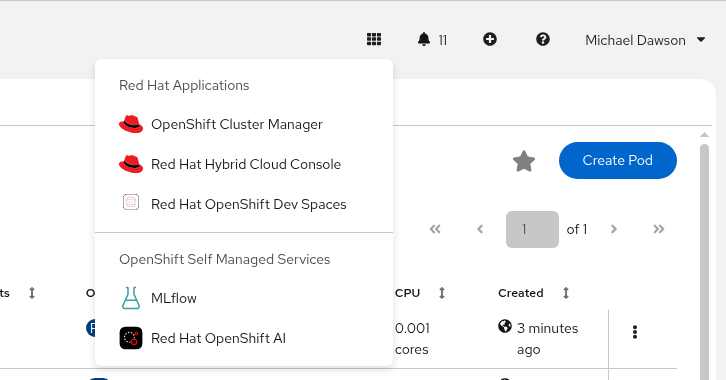

Next select the workspace you deployed the quickstart to:


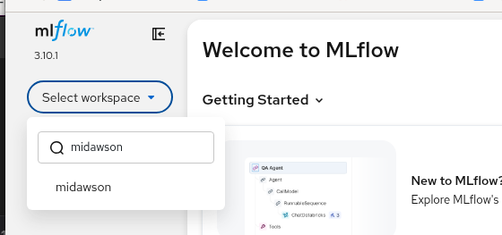

You should now see an overview with one experiment listed. This was the experiment created when you deployed with
tracing enabled:


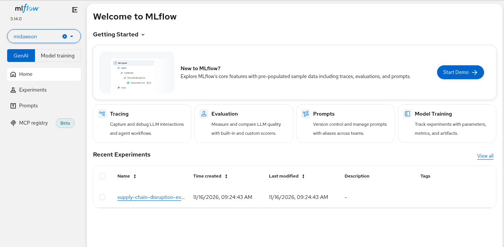

From that page select the experiment and then select `Evaluation runs` on the left side menu
and you should see one evaluation listed:

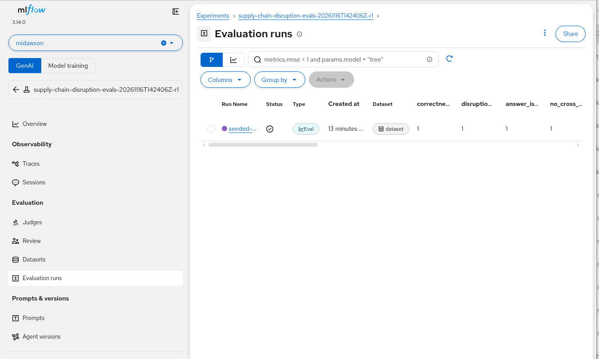

Select that evaluation, then adjust the columns to show the base attributes and all assessments. The table lists the questions and evaluation results for each metric. Hover over Pass/Fail results to read the judge explanations. For the evaluation questions, see [seeded-disruptions.json](evaluation/ui/datasets/seeded-disruptions.json). For scorer definitions, see [`_build_scorers`](evaluation/ui/run_eval.py#L1141) and [scorers.py](evaluation/ui/scorers.py#L49).

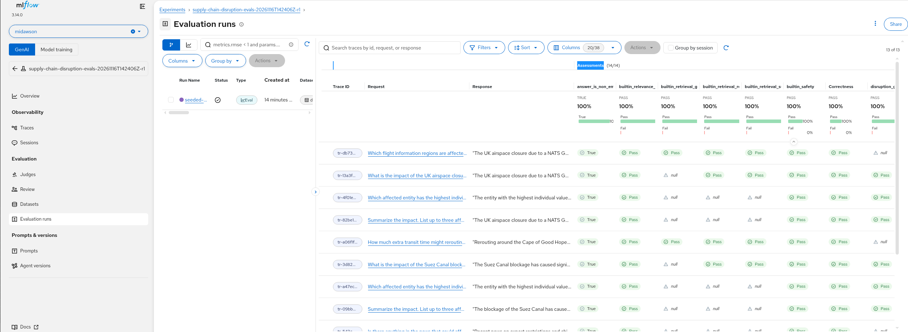

You can now explore the evaluation results in more detail or look at the traces for each of the questions and answers to understand the interaction with the agent in more detail.

#### Adapt flight data to your organization (optional)

You can use a YAML file to show flights your company regularly carries cargo on and attach your shipment details to each flight. The default OpenSky import provides live aircraft positions, but its generated cargo values are demo data, not your shipment manifest. Flights declared in YAML use the coordinates you provide and stay there until you reseed them.

1. Copy the example manifest to `data/supply-chain-network.yaml`. When this file exists, `make seed-customer-data` uses it automatically; if it is absent, the target uses the committed example. The local file is gitignored:

   ```bash
   cp data/supply-chain-network.example.yaml data/supply-chain-network.yaml
   ```

2. Edit the manifest. Set a `company_id` and `company_name` at the top level to tag your flights, then add each flight with a stable, unique `id`, its callsign and route, and its map coordinates. Add cargo as top-level records whose `carrier_id` matches the flight's `id`:

   ```yaml
   version: "1"
   dataset_id: "my-customer-network"
   company_id: "company-acme"
   company_name: "Acme Air Cargo"

   flights:
     - id: flight-customer-001
       callsign: ACME123
       route: LHR-NAP
       origin: United Kingdom
       status: airborne
       lon: 14.18
       lat: 40.76

   cargo:
     - id: cargo-customer-001-pharma
       carrier_id: flight-customer-001
       commodity: pharmaceuticals
       quantity: 6
       unit_price_usd: 8500
   ```

Add one cargo record per shipment or cargo group, with its commodity, quantity, and unit price. The popup uses these fields to show the cargo and its value. Add airports, ports, vessels, or inventory SKUs in the same file as needed; the example manifest shows their fields.

3. After `make install-full`, import your file and refresh the UI 

   ```bash
   make seed-customer-data
   ```

To use a file at another path instead, run `make seed-customer-data NETWORK_YAML=path/to/file.yaml`. Reusing an entity `id` updates that record; new IDs add records. The overlay does not delete existing demo or OpenSky entities.

For a first-time install, `make install-full` imports the files listed under `seed.networkFiles` in `helm/values.yaml`. Add your local manifest to that list if you want it included during installation. Set `seed.opensky.enabled: false` in the values file to skip the additional OpenSky aircraft.

#### Modifying the application (optional)

By default the deployment uses images that have been pre-built and pushed to the rh-ai-quickstart organization in quay.io. Quickstart images use `REGISTRY`; general-simulation images use `REGISTRY_GEN_SIM` and default `GEN_SIM_TAG` to the committed submodule short SHA (override it with your chosen tag).

To build and push quickstart images instead of using the default Quay images, replace `your-org` with your Quay organization:

```
make build REGISTRY=quay.io/your-org
make release REGISTRY=quay.io/your-org
```

You will then need to run `make helm-uninstall` followed by `make install-full ...` (where ... are the options you used as explained earlier) after setting `REGISTRY=quay.io/your-org`.

### Delete

To completely remove the deployment:

```bash
make helm-uninstall
```

Optionally delete the project:

```bash
oc delete project supply-chain-dashboard
```

## Reference

- [What to expect after deployment](./docs/WHAT_TO_EXPECT.md)
- [Supply-chain KPIs](./docs/KPIS.md) — formulas, data sources, and healthy vs disrupted modes
- [OGX documentation](https://ogx-ai.github.io/docs)
- [LangChain PGVector integration](https://python.langchain.com/docs/integrations/vectorstores/pgvector/)
- [React Leaflet](https://react-leaflet.js.org/)
- [OpenShift AI documentation](https://docs.redhat.com/en/documentation/red_hat_openshift_ai_self-managed)

## Tags

<!--
Title: Handle Supply Chain Disruptions with agentic AI
Description: Help logistics operators simulate disruptions and query risk documents with agentic AI on OpenShift AI.
Industry: Manufacturing
Product: OpenShift AI
Use case: AI agents, RAG, supply chain intelligence
Contributor org: Red Hat
-->

- **Title:** Handle Supply Chain Disruptions with agentic AI
- **Description:** Help logistics operators simulate disruptions and query risk documents with agentic AI on OpenShift AI.
- **Industry:** Manufacturing
- **Product:** OpenShift AI
- **Use case:** AI agents, RAG, supply chain intelligence
- **Contributor org:** Red Hat
